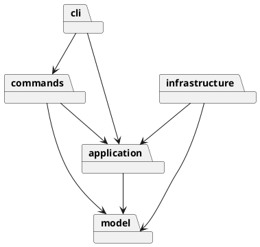

# SVG 编辑器 Phase 1

## 架构方案

采用 TypeScript 面向对象实现。一类一文件，图形通过多态承担属性验证、移动、缩放和显示职责。

| 模块 | 职责 | 可依赖 |
|---|---|---|
| `src/model` | 图形、组合树、画布、图形工厂 | 本模块 |
| `src/application` | 编辑器状态、命令接口、历史、文件端口 | model |
| `src/commands` | 每条 CLI 命令的执行对象 | application、model |
| `src/infrastructure` | SVG XML 编解码、文件读写 | application、model、XML 库、Node |
| `src/cli` | 分词、命令注册及 REPL | commands、application、Node |
| `src/Main.ts` | 装配入口 | 全部模块 |

设计模式：Command（每条命令为对象，编辑命令一个历史单元）；Composite（Group 与叶子共同继承 Shape，容器递归移动/缩放）；Memento（编辑前后保存深拷贝快照，失败回滚）；Factory（六种内置图形的构造和 XML 导入入口）；端口/适配器隔离文件 IO。

仅命令注册表和 ShapeFactory 按名字选择实现。这两处是后续插件化阶段的待重构点，Phase 1 不实现 box。快照历史优先保证原子性，代价是每次编辑 O(n) 内存；大文档阶段再改为增量撤销。

变化点：新增图形通过子类与工厂登记；新增 CLI 命令通过命令类与注册表；未来 GUI 可调用应用层；文件格式由 FilePort 替换；插件加载暂不预留复杂框架。

## 过程记录

- 初始项目仅包含 `phase_cli_1.md`，无代码与远程仓库配置。
- 先确定模型/命令/IO 边界，再分步实现；开发记录使用实际 Git 提交，不伪造人与 AI 的讨论。
- 需求特例：根级 g 禁止 ungroup；canvas 查询不阻断历史；只有成功 IO 才阻断历史；外部缺 id 必须先收集所有显式 id，避免自动编号抢占后续 id。
- 编译暴露了 DOM 根元素类型过窄的问题：SVG 子节点不能赋给 HTMLElement；将递归序列化的父节点类型明确为 Element 后通过严格检查。
- 首轮 19 项功能测试中，18 项通过，临时文件保存失败。独立的最小 write/rename 探针确认是执行沙箱禁止 rename（EPERM），在授权环境运行后 19 项全部通过。保留同目录临时文件 + rename 的原子保存方案，没有为了绕过环境限制降级为直接覆盖。
- 审查时明确解组需要保留组级继承样式，避免删除组后子图形颜色变化；测试验证解组位置、样式及撤销恢复。
- 最后增加模块依赖检查以及所有叶子几何变换和文本撤销/往返测试。
- 流程图回放验证为 3 个 g、2 个 rect、2 个 text、1 个 line，共 8 个元素，与需求一致；根 svg 不计入。

## 一致性自查

1. 实际目录与架构方案一致。`src/Main.ts` 是唯一装配入口；测试和示例分别置于 `test/`、`examples/`。
2. 依赖规则没有已知违反。自动化测试扫描全部模块 import，检查许可方向与一类一文件。模型不依赖文件系统、CLI 或 XML 库；应用层通过 FilePort 访问文件；命令处理器不做 IO。
3. 图形类型选择仅位于 ShapeFactory，命令选择仅位于 CommandRegistry。显示和变换调用 Shape 多态方法；容器能力使用 Group 类型检查，不使用 switch(tag) 分派。

### 需求未明确处的决策

- group 的成员顺序采用原文档深度优先顺序，不采用参数顺序。同父节点时放在第一个成员原位置；跨父节点时挂到根，并尽可能复用首个成员的位置，否则追加。
- front 将元素放到同级数组末尾（SVG 后绘制，显示在最前），back 放到开头。
- save 后的路径成为后续无参数 save 的默认路径。失败 IO 不清空历史；成功 IO 清空旧历史并设置禁用标志，新编辑解除禁用。
- 历史摘要使用 `undone: ...` / `redone: ...`，实际数据完整还原；提示语不逐字模仿示例中的每种英文句式。
- `help` 在无文档时可用；其他涉及文档的命令要求先 init/read。

### SVG 支持边界

- 支持六种内置元素、嵌套、白名单属性、文本内容、实体转义、注释、可选 SVG 命名空间与 px 画布尺寸。
- 外部元素缺失的几何属性按 0 处理；画布缺尺寸默认 800×600。外部 data-* 标记忽略，含 data-kind="box" 的普通 g 因此降级为 g。
- 本阶段并非通用 SVG 浏览器：不支持 path/use、CSS/style、transform、字体属性、非默认 viewBox、非 px 尺寸、DTD 与实体声明。遇到超出范围的内容明确报错，避免静默损坏。需求开头的 transform 是 SVG 背景示例，CLI 容器移动/缩放使用递归更新几何属性。
- set 仍严格采用需求白名单；g 的 fill/stroke/stroke-width 按 SVG 继承语义生效，解组时复制尚未覆盖的组样式到直接子节点。
- box 插件及复合类型的专有 ungroup 错误属于后续阶段，Phase 1 创建 box 报 unknown shape type。

## 质量保证手段

执行 `npm test`：先严格 TypeScript 编译，再运行 Node 内置测试。覆盖全部 19 个命令、六种类型、嵌套与分组顺序、根级解组限制、循环防护、z-order、中文及引号、数值校验、失败回滚（包含递归中途溢出）、撤销重做与分支清空、IO 历史屏障、缺 id 补全与冲突、重复 id、XML 转义与读写往返、文件错误、树形输出及架构依赖。

最终验证结果（2026-10-23，Node.js 24.20.0）：21 项测试全部通过；TypeScript 严格编译通过；完整流程图 CLI 回放成功，`examples/flowchart.svg` 已生成且包含 8 个图形元素。

保存先完成 XML 编码，再写入同目录唯一临时文件并 rename 替换目标，失败会清理临时文件。正常环境应支持目标目录写入及 rename；受限执行沙箱可能需要授权。

手工验收命令：`Get-Content -Encoding utf8 examples/flowchart.txt | npm run cli`。输出 SVG 可以直接用浏览器打开；外部导入示例 `examples/other.svg` 应显示 7 个元素及 1 条补 id 警告。

## Git 提交与交付

开发按架构骨架、模型/命令、CLI/IO/测试、最终自查分步提交。最终本地提交标记为 `final`。提交截止时间未提供，无法验证是否早于截止。

用户指定远程仓库：`https://github.com/OtsutsukiKaguya/svg_cli.git`，配置为 origin。2026-10-23 首次检查因 GitHub 凭据无效而阻塞；用户修复凭据后，确认远程为空，并按开发顺序分五批推送了现有提交（架构骨架、模型/命令、CLI/IO/测试、最终自查、首次认证阻塞记录）。本次补充交付记录作为最后一次文档提交，`final` 指向该提交。开发历史完整保留，没有合并成一次大提交或覆盖远程历史。
