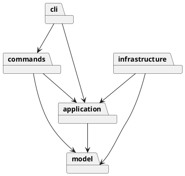

# SVG 编辑器 Phase 1

## 架构方案

采用 TypeScript 面向对象实现。一类一文件，图形通过多态承担属性验证、移动、缩放和显示职责。

| 模块 | 职责 | 可依赖 |
|---|---|---|
| `src/model` | 图形、组合树、画布、图形工厂 | 本模块 |
| `src/application` | 编辑器状态、命令接口、历史、文件端口 | model |
| `src/commands` | 每条 CLI 命令的执行对象 | application、model |
| `src/infrastructure` | SVG XML 编解码、文件读写 | application、model、XML 库、Node |
| `src/cli` | 分词、命令注册及 REPL | commands、application、Node |
| `src/Main.ts` | 装配入口 | 全部模块 |

设计模式：Command（每条命令为对象，编辑命令一个历史单元）；Composite（Group 与叶子共同继承 Shape，容器递归移动/缩放）；Memento（编辑前后保存深拷贝快照，失败回滚）；Factory（六种内置图形的构造和 XML 导入入口）；端口/适配器隔离文件 IO。

仅命令注册表和 ShapeFactory 按名字选择实现。这两处是后续插件化阶段的待重构点，Phase 1 不实现 box。快照历史优先保证原子性，代价是每次编辑 O(n) 内存；大文档阶段再改为增量撤销。

变化点：新增图形通过子类与工厂登记；新增 CLI 命令通过命令类与注册表；未来 GUI 可调用应用层；文件格式由 FilePort 替换；插件加载暂不预留复杂框架。

## 过程记录

- 初始项目仅包含 `phase_cli_1.md`，无代码与远程仓库配置。
- 先确定模型/命令/IO 边界，再分步实现；开发记录使用实际 Git 提交，不伪造人与 AI 的讨论。
- 需求特例：根级 g 禁止 ungroup；canvas 查询不阻断历史；只有成功 IO 才阻断历史；外部缺 id 必须先收集所有显式 id，避免自动编号抢占后续 id。

## 一致性自查

待实现完成后更新。

## 质量保证手段

待自动化测试和 CLI 回放完成后更新。
